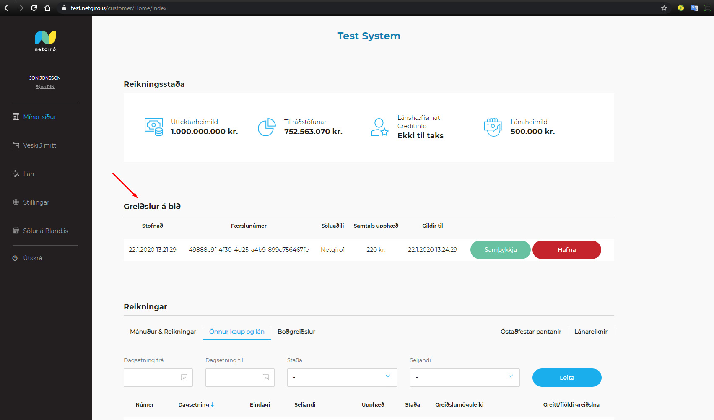

# Test customer info

[https://customer.test.netgiro.is/](https://customer.test.netgiro.is/)

## Test phone numbers

The quickest way to test a payment is to use one of these phone numbers as the customer. Each one drives the payment to a fixed outcome without the Netgiro app or an electronic ID. They work in [hosted checkout](/docs/hosted-checkout) and as the `CustomerIdentifier` of the [V2 API](/docs/api/checkout/payment), on the test environment only.

| Phone number | Outcome |
|--------------|---------|
| `8111111` | Approved. The payment goes through on test customer 1111111119. You get the confirm callback, and in hosted checkout the redirect to `SuccessUrl` |
| `8222222` | Declined. The payment is cancelled, like a customer rejecting it in the app. You get the cancel callback, and in hosted checkout the redirect to `CancelUrl` |

In the V2 API both start as `Pending`, like any phone payment. Poll the [payment status](/docs/api/checkout/status) to see the outcome.

:::note Password payments are disabled
Paying with kennitala and password on the checkout page is disabled for all merchants. Use the test phone numbers above, or a real payment request confirmed by the test customer as described below.
:::

## Test customer credentials

**Customer 1** - Has unlimited credit for purchases

- SSN: 1111111119
- Password: meerko1

This is the only account that can sign in to the test customer panel with kennitala and password.

## GSM payment verification

To confirm a payment created with GSM number, you can login to the customer panel using the credentials for the Test customer as above.

**SSN** for testing is **1111111119**, **GSM** for testing is **8223281**, **AppCode** can be generated on the [API/POS testing page](./api-pos.md)

